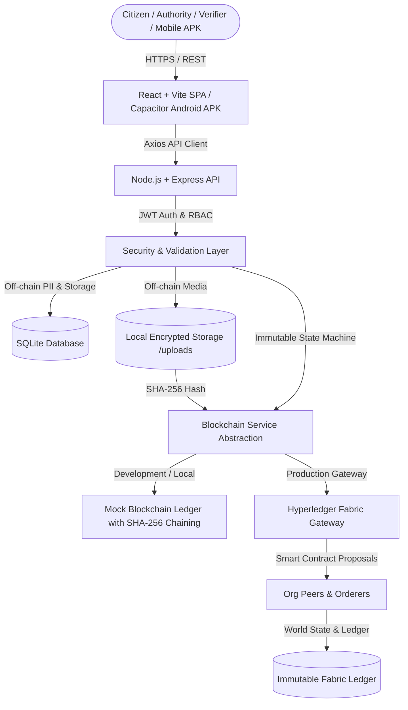
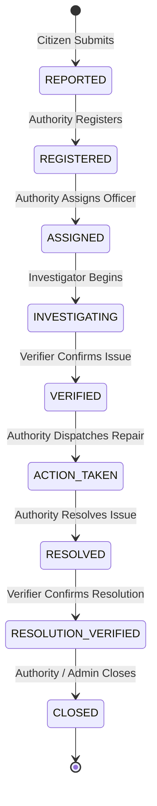

# ⛓ CivicChain

> **Privacy-Preserving Civic Grievance & Public Facility Redressal Platform on Hyperledger Fabric & Android (Capacitor)**

CivicChain is a full-stack, enterprise-grade civic grievance redressal and accountability system. It provides citizens, municipal authorities, field investigators, and independent verifiers with a transparent, privacy-preserving, and tamper-evident audit trail backed by permissioned blockchain technology (Hyperledger Fabric) with responsive Web and native Android APK clients.

---

## 📑 Table of Contents
1. [Project Overview](#-project-overview)
2. [Key Architecture & Principles](#-key-architecture--principles)
3. [Complaint State Machine Lifecycle](#-complaint-state-machine-lifecycle)
4. [User Roles & RBAC](#-user-roles--rbac)
5. [On-Chain vs Off-Chain Data Privacy](#-on-chain-vs-off-chain-data-privacy)
6. [Technology Stack](#-technology-stack)
7. [Repository Structure](#-repository-structure)
8. [Installation & Setup](#-installation--setup)
9. [Android APK Build & Deployment](#-android-apk-build--deployment)
10. [Pre-configured Test Accounts](#-pre-configured-test-accounts)
11. [REST API Documentation](#-rest-api-documentation)
12. [End-to-End Automated Testing](#-end-to-end-automated-testing)
13. [Hyperledger Fabric Setup](#-hyperledger-fabric-setup)
14. [Troubleshooting & Mobile Connectivity](#-troubleshooting--mobile-connectivity)

---

## 🏛 Project Overview

Public infrastructure (roads, streetlights, drainage, water supply, schools, sanitation) often suffers from maintenance delays, contractor negligence, or lack of accountability. Centralized grievance portals suffer from:
- Single points of failure and unauthorized alteration of records.
- Lack of citizen privacy (PII leakage).
- Unverifiable repair claims.

**CivicChain solves this by:**
1. **Enforcing strict state machine transitions** on-chain so tickets cannot be prematurely resolved or deleted.
2. **Pseudonymizing citizen identity** via cryptographic SHA-256 hashes on the public ledger.
3. **Cryptographically hashing all uploaded evidence** (photos/inspections) to guarantee tamper-evidence.
4. **Providing multi-party verification** involving separate investigator and verifier roles.
5. **Enabling field reporting via an Android APK** with camera and GPS support for field officers and citizens.

---

## 🏗 Architecture



---

## 🔄 Complaint State Machine Lifecycle

The platform strictly enforces the following transition sequence. **Invalid state transitions (e.g. `REPORTED` → `CLOSED`, or `CLOSED` → `INVESTIGATING`) are strictly rejected with HTTP 400 both at the API layer and within the smart contract.**



---

## 👥 User Roles & RBAC

| Role | Allowed Actions |
|---|---|
| **CITIZEN** | Submit complaint, upload initial evidence, track complaint status, view own audit trail, confirm resolution feedback. |
| **AUTHORITY** | Register complaints, assign officers/investigators, take action, resolve complaints, close verified complaints, view ward analytics. |
| **INVESTIGATOR** | Conduct site visits, log investigation notes, upload inspection photographs, submit verification requests. |
| **VERIFIER** | Independently inspect and verify reported issues and post-action repair quality before closure. |
| **ADMIN** | System oversight, role management, user activation/deactivation, comprehensive ledger inspection. |

---

## 🔐 On-Chain vs Off-Chain Data Privacy

| Data Category | Storage Location | Details |
|---|---|---|
| **Citizen PII** (Name, Email, Phone) | Off-Chain (SQLite) | Never written to the ledger; pseudonymized with SHA-256 hash. |
| **Complaint Metadata & State** | On-Chain (Fabric / Ledger) | Complaint ID, Category, Ward, Current State, Timestamps. |
| **Evidence Photos & Documents** | Off-Chain (`/uploads`) | Raw files kept in protected storage; only accessible to authorized roles. |
| **Evidence Proofs** | On-Chain (Fabric / Ledger) | SHA-256 digest of each file is anchored on-chain to detect any tampering. |
| **Audit Events** | On-Chain (Fabric / Ledger) | Every transition generates a tamper-evident transaction ID and block record. |

---

## 💻 Technology Stack

- **Frontend Web & Mobile**: React 19, Vite, Capacitor 8 (Android), React Router 7, TanStack Query, Lucide Icons, React Hot Toast.
- **Backend**: Node.js (ESM), Express.js, SQLite3 with `sqlite` async wrapper, JWT, Bcrypt, Multer, Helmet, CORS.
- **Blockchain**: Hyperledger Fabric (Gateway SDK, Chaincode Node API, Mock SHA-256 chained ledger fallback).
- **Mobile Runtime**: Capacitor Android Bridge, Android SDK (API 34/35), Java 17/21.
- **Security**: SHA-256 cryptographic hashing, role-based middleware, UUIDv4 tokens.

---

## 📁 Repository Structure

```
blockchain/
├── CivicChain-Reporter-debug.apk   # Ready-to-install Android Debug APK
├── test-apk-and-backend.js         # Comprehensive APK & Backend automated test suite
├── backend/
│   ├── data/civicchain.db          # Application SQLite database
│   ├── src/
│   │   ├── config/database.js      # Database initialization & table schemas
│   │   ├── controllers/            # Auth, complaints, dashboard, evidence, users
│   │   ├── middleware/             # JWT auth & RBAC authorization
│   │   ├── routes/                 # Express API routes
│   │   ├── services/               # BlockchainService (Mock & Fabric Gateway)
│   │   ├── utils/seed.js           # Database seeder with demo accounts
│   │   └── server.js               # Main Express server with mobile CORS support
│   └── test-e2e.js                 # 21-step automated end-to-end integration test
├── blockchain/
│   ├── chaincode/                  # Hyperledger Fabric Smart Contract (Node.js)
│   ├── network/                    # Connection profiles & Fabric configuration
│   └── scripts/                    # Shell scripts for network deployment
├── frontend/
│   ├── android/                    # Android Studio / Gradle native project
│   │   └── app/build/outputs/apk/  # Built APK outputs (debug/release)
│   ├── src/
│   │   ├── components/             # Layout, Navigation, Badges, UI components
│   │   ├── context/AuthContext.jsx # Auth provider with localStorage persistence
│   │   ├── pages/                  # Landing, Login (with Server Config), Dashboards, Complaints
│   │   ├── services/api.js         # Axios client with dynamic IP resolution & health diagnostics
│   │   ├── App.jsx                 # Routing & ProtectedRoute role guards
│   │   └── index.css               # Modern Civic theme design system
│   ├── capacitor.config.json       # Capacitor Android configuration
│   └── index.html
└── uploads/                        # Off-chain evidence storage directory
```

---

## 🚀 Installation & Setup

### Prerequisites
- **Node.js**: v18 or higher
- **npm**: v9 or higher
- **Java JDK** (for Android APK builds): JDK 17 or JDK 21

### 1. Backend Setup
```bash
# 1. Navigate to backend
cd backend

# 2. Install dependencies
npm install

# 3. Seed database with initial users and civic data
npm run seed

# 4. Start the backend server (Port 5000)
npm start
```

### 2. Frontend Web Setup
```bash
# 1. Navigate to frontend
cd ../frontend

# 2. Install dependencies
npm install

# 3. Start Vite development server
npm run dev
# Accessible at http://localhost:5173
```

---

## 📱 Android APK Build & Deployment

### Ready-to-Install APK
You can directly grab the compiled APK from:
- **Project Root**: [`CivicChain-Reporter-debug.apk`](./CivicChain-Reporter-debug.apk)
- **Gradle Output**: [`frontend/android/app/build/outputs/apk/debug/app-debug.apk`](./frontend/android/app/build/outputs/apk/debug/app-debug.apk)

### How to Build the APK from Source
```bash
cd frontend

# 1. Build the web production assets
npm run build

# 2. Sync web assets into the Android native project
npx cap sync android

# 3. Build the Android debug APK using Gradle
cd android
.\gradlew.bat assembleDebug

# Output APK will be at:
# frontend/android/app/build/outputs/apk/debug/app-debug.apk
```

### How to Install & Run on Phone / Emulator
```powershell
# Install on connected device or emulator via ADB
adb install -r c:\Users\SATHYA\Downloads\blockchain\CivicChain-Reporter-debug.apk
```

---

## 🔑 Pre-configured Test Accounts

| Role | Email | Password |
|---|---|---|
| **ADMIN** | `admin@civicchain.gov` | `Admin@123` |
| **CITIZEN** | `citizen@example.com` | `Citizen@123` |
| **CITIZEN 2** | `citizen2@example.com` | `Citizen@123` |
| **AUTHORITY** | `authority@civicchain.gov` | `Authority@123` |
| **INVESTIGATOR** | `investigator@civicchain.gov` | `Investigator@123` |
| **VERIFIER** | `verifier@civicchain.gov` | `Verifier@123` |

> *Tip: The Login page contains one-click demo buttons to instantly log into each role without typing credentials.*

---

## 📡 REST API Documentation

### Authentication
- `POST /api/auth/register` — Register a new citizen account
- `POST /api/auth/login` — Login with email/password and obtain JWT token
- `GET /api/auth/me` — Retrieve current authenticated user profile

### Complaints & Lifecycle
- `GET /api/complaints` — List complaints (filtered by role/ward/category)
- `POST /api/complaints` — Submit a complaint (`REPORTED`)
- `GET /api/complaints/:id` — View complaint details and evidence
- `GET /api/complaints/:id/history` — Fetch immutable timeline and blockchain records
- `PUT /api/complaints/:id/register` — Register complaint (`REGISTERED`)
- `PUT /api/complaints/:id/assign` — Assign complaint to officer (`ASSIGNED`)
- `PUT /api/complaints/:id/investigate` — Begin site inspection (`INVESTIGATING`)
- `PUT /api/complaints/:id/verify` — Verify reported issue (`VERIFIED`)
- `PUT /api/complaints/:id/action` — Dispatch repairs (`ACTION_TAKEN`)
- `PUT /api/complaints/:id/resolve` — Submit resolution summary (`RESOLVED`)
- `PUT /api/complaints/:id/verify-resolution` — Inspect resolution (`RESOLUTION_VERIFIED`)
- `PUT /api/complaints/:id/close` — Formally close complaint (`CLOSED`)

### Evidence & Ledger
- `POST /api/complaints/:id/evidence` — Multipart upload with automated SHA-256 hashing
- `GET /api/evidence/:id/verify` — Cryptographically verify evidence integrity against ledger hash
- `GET /api/blockchain/explorer` — View on-chain blocks and transactions
- `GET /api/blockchain/verify-integrity` — Audit all records for tampering

---

## 🧪 End-to-End Automated Testing

CivicChain includes two automated test suites:

### 1. APK & Mobile Integration Test (`test-apk-and-backend.js`)
Tests APK files, manifest permissions, backend CORS for Android WebViews, and the full multi-role auth matrix:
```bash
node test-apk-and-backend.js
```
```text
====================================================
🔍 CIVICCHAIN APK & BACKEND COMPREHENSIVE TEST SUITE
====================================================
📦 1. VERIFYING ANDROID APK ASSETS & CONFIGURATION
  ✅ [PASS] APK exists at frontend/android/app/build/outputs/apk/debug/app-debug.apk
  ✅ [PASS] APK file size valid (4.11 MB)
  ✅ [PASS] AndroidManifest has INTERNET permission
  ✅ [PASS] AndroidManifest allows cleartext HTTP traffic
  ✅ [PASS] Capacitor config allows cleartext traffic
  ✅ [PASS] Frontend web bundle synced inside Android assets

🌐 2. TESTING BACKEND CONNECTIVITY & CORS FOR MOBILE APK
  ✅ [PASS] Backend Health Endpoint (/api/health) returns 200 OK
  ✅ [PASS] Backend CORS permits Android APK WebView origin (https://localhost)
  ✅ [PASS] Backend CORS permits Capacitor custom origin (capacitor://localhost)

🔐 3. TESTING APK AUTHENTICATION MATRIX
  ✅ [PASS] Login successful for Citizen (citizen@example.com)
  ✅ [PASS] Login successful for Admin (admin@civicchain.gov)
  ✅ [PASS] Login successful for Authority (authority@civicchain.gov)
  ✅ [PASS] Login successful for Investigator (investigator@civicchain.gov)
  ✅ [PASS] Login successful for Verifier (verifier@civicchain.gov)
  ✅ [PASS] Invalid credentials properly rejected with 401/400

📊 TEST SUMMARY: 21 / 21 checks passed (100%)
```

### 2. Full State Machine & Blockchain Integrity Test (`backend/test-e2e.js`)
```bash
cd backend
node test-e2e.js
```
```text
========================================
🎉 TEST SUMMARY: 21 PASSED, 0 FAILED
========================================
```

---

## 🔗 Hyperledger Fabric Setup

To connect to a live Hyperledger Fabric production network:

1. Update `backend/.env`:
   ```env
   BLOCKCHAIN_MODE=fabric
   FABRIC_CHANNEL_NAME=mychannel
   FABRIC_CHAINCODE_NAME=civicchain
   FABRIC_MSP_ID=Org1MSP
   FABRIC_PEER_ENDPOINT=localhost:7051
   FABRIC_TLS_CERT_PATH=../blockchain/network/organizations/peerOrganizations/org1.example.com/tlsca/tlsca.org1.example.com-cert.pem
   FABRIC_WALLET_PATH=./wallet
   ```

2. Deploy the chaincode:
   ```bash
   cd blockchain/scripts
   bash deployChaincode.sh
   ```

---

## 🔧 Troubleshooting & Mobile Connectivity

| Problem | Cause | Solution |
|---|---|---|
| **Cannot log in on Physical Phone APK** | The phone cannot reach `localhost:5000` on the PC. | On the app login screen, tap **Server Config** and select **📶 Phone Wi-Fi LAN** (`http://192.168.29.19:5000/api`). Ensure your phone is connected to the same Wi-Fi. |
| **Cannot log in on Android Emulator** | Android Emulator uses a virtual router loopback. | In **Server Config**, select **📱 Android Emulator** (`http://10.0.2.2:5000/api`). |
| **Server Unreachable error** | Backend process is not running. | Run `npm start` in the `backend/` directory. Check `http://localhost:5000/api/health` in your browser. |
| **Cleartext HTTP Warning** | Android 9+ blocks unencrypted `http://` by default. | `AndroidManifest.xml` is pre-configured with `android:usesCleartextTraffic="true"`. |
